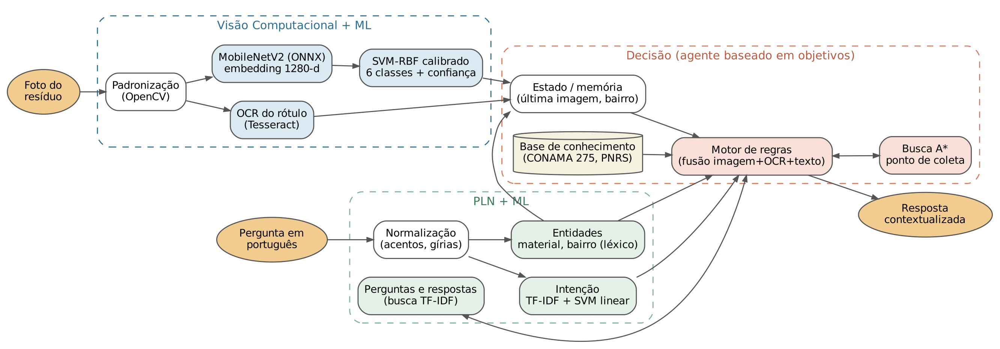

# ♻️ EcoTriagem — identificação de resíduos e orientação de descarte com IA

**Projeto Integrador Final — Inteligência Artificial Aplicada**
AFYA • UNIMA Maceió · Disciplina: Inteligência Artificial · Prof. Icaro Ferreira
Tema escolhido: **Projeto B — Identificação e classificação de resíduos**

> Artigo científico (Overleaf):(https://www.overleaf.com/project/6afe4ca23c10ba01d9fcc120/share#3f3572003869c83075b9d51ee68c730d673489724966dc53) · PDF: [`artigo/artigo.pdf`](artigo/artigo.pdf)

---

## Integrantes e responsabilidades

| Integrante | Responsabilidades principais |
|---|---|
| Marivan Olivares | Preparação do TrashNet e remoção de duplicatas; Visão Computacional (extração de características, classificadores e calibração) e OCR; experimentos E1–E3 e E5 |
| Humberto Torres | Conjunto de intenções em português; PLN (normalização, classificador de intenções, extrator de entidades, FAQ) e sua avaliação |
| Vinicius | Base de conhecimento, motor de regras, mapa e busca A* com comparação de algoritmos (E4); integração em Streamlit, avaliação ponta a ponta (E6) e repositório |

Todos participaram da definição da arquitetura e da redação do artigo.

---

## 1. Problema

O descarte incorreto contamina materiais recicláveis e reduz a renda de cooperativas de catadores. Muitas pessoas não sabem **de que material** é um resíduo, **em qual lixeira** ele vai (cores da Resolução CONAMA 275/2001), **como prepará-lo** e **onde entregá-lo**. O **EcoTriagem** recebe a **foto** de um resíduo e **perguntas em português** e devolve uma resposta contextualizada: material, lixeira, cuidados, se é reciclável e a rota até o ponto de coleta mais próximo que aceita aquele material.

**Público-alvo:** moradores de Maceió e comunidade acadêmica. **Objetivos:** (i) classificar o material por imagem com confiança calibrada; (ii) interpretar perguntas em linguagem natural; (iii) combinar as evidências com regras explicáveis e busca heurística; (iv) avaliar cada módulo e o fluxo completo com métricas reais.

## 2. Como os requisitos do projeto foram atendidos

| Requisito (seção do enunciado) | Implementação | Onde |
|---|---|---|
| 4.1 Agentes, busca, heurísticas, regras | **Agente baseado em objetivos** (PEAS, estado/memória) + **motor de regras** com encadeamento para frente (22 regras) + **A\*** com heurística admissível (haversine), comparado a BFS, custo uniforme e gulosa | `src/decisao/` |
| 4.2 Machine Learning | **Supervisionado**: 7 classificadores visuais comparados (SVM, Random Forest, k-NN, Regressão Logística) e 6 de intenção (NB, Reg. Log., SVM); **não supervisionado**: k-means sobre embeddings | `src/machine_learning/`, `scripts/treinar_*.py` |
| 4.3 Visão Computacional | Classificação de imagens (MobileNetV2 pré-treinada como extrator + classificador treinado), características clássicas (HSV, LBP, HOG), **OCR** de rótulos (Tesseract), testes de robustez | `src/visao_computacional/` |
| 4.4 PLN | **Reconhecimento de intenções** (9 classes), **extração de entidades** (material, bairro), **perguntas e respostas** por recuperação | `src/pln/` |
| 4.5 Integração | Um único fluxo: imagem → visão+OCR → estado do agente; pergunta → intenção+entidades → regras (fusão) → A* → resposta | `src/integracao/pipeline.py`, `app/`, `demo.py` |

## 3. Arquitetura



1. **Visão Computacional + ML** — a imagem é padronizada (OpenCV) e passa pela **MobileNetV2** (ImageNet, ONNX, executada pelo `cv2.dnn`, sem GPU). O vetor de 1280 dimensões do *global average pooling* alimenta um **SVM-RBF com calibração isotônica** que devolve 6 probabilidades. Em paralelo, o **Tesseract** lê textos de rótulos ("PET", "ALUMÍNIO", "VIDRO"...).
2. **PLN** — a pergunta é normalizada (acentos, gírias como *vc/pra/q*), representada por **TF-IDF de palavras e de n-gramas de caracteres** e classificada em uma de 9 **intenções** por um **SVM linear calibrado**. Um **extrator de entidades** baseado em léxico (com casamento aproximado para erros de digitação) encontra o material citado e o bairro.
3. **Decisão** — o **agente** guarda o estado da conversa (última imagem, bairro). O **motor de regras** decide o material fundindo imagem, OCR e texto conforme a confiança (aceita, pede confirmação ou pede outra foto), consulta a base de conhecimento e, se a intenção for "ponto de coleta", executa a **busca A\*** no grafo de bairros. O rastro de regras disparadas explica cada resposta.

## 4. Dados

| Conjunto | Origem / licença | Preparação |
|---|---|---|
| **TrashNet** (2.527 fotos, 6 classes: papelão, vidro, metal, papel, plástico, rejeito) | Thung & Yang (2016), [github.com/garythung/trashnet](https://github.com/garythung/trashnet), MIT | validação de leitura; detecção de quase-duplicatas (dHash 16×16 + diferença de pixels); **3 pares de fotos idênticas com rótulos diferentes foram removidos (6 imagens)**; duplicatas da mesma classe mantidas na mesma partição; divisão estratificada **70/15/15** (1.765/377/379), semente 42 |
| **Intenções — treino** (1.170 frases, 9 intenções) | autoral (`scripts/gerar_dataset_pln.py`): 190 templates redigidos pela equipe + aumento (sem acento, gírias, erros de digitação) | validação cruzada de 5 dobras para seleção do modelo |
| **Intenções — teste** (132 frases) | autoral, **escrito à mão**, independente dos templates (0 frases coincidentes) | anotado com intenção, material e bairro |
| **Base de conhecimento** | Resolução CONAMA 275/2001 (cores), Lei 12.305/2010 (PNRS) | `dados/conhecimento/*.json` |
| **Mapa de Maceió** (32 bairros, 62 arestas, 10 pontos) | coordenadas aproximadas; **pontos de coleta fictícios** (cenário simulado) | custo da aresta = haversine × fator de tortuosidade ∈ [1,2; 1,6) |
| **MobileNetV2 (ONNX)** | ONNX Model Zoo, Apache-2.0 | baixada por `scripts/baixar_dados.py` |

Nenhum dado pessoal é coletado. Os dados brutos não são versionados (são baixados pelo script).

## 5. Instalação

Requisitos: **Python ≥ 3.10**, ~1 GB livre, CPU comum (não precisa de GPU). Para o OCR, instale o **Tesseract** com o idioma português (opcional — sem ele o sistema funciona, apenas sem ler rótulos).

```bash
git clone https://github.com/Marivan-Olivares/Ecotriagem.git ecotriagem && cd ecotriagem
python -m venv .venv && source .venv/bin/activate      # Windows: .venv\Scripts\activate
pip install -r requirements.txt
sudo apt install tesseract-ocr tesseract-ocr-por        # opcional (Linux)
```

## 6. Execução

**Reprodução completa** (dados → modelos → experimentos → demo → testes → notebook; ~15 min em CPU de 2 núcleos):

```bash
bash scripts/reproduzir.sh
```

Ou passo a passo:

```bash
python scripts/baixar_dados.py            # TrashNet + MobileNetV2 (≈57 MB)
python scripts/preparar_dados.py          # limpeza, duplicatas, divisão 70/15/15
python scripts/gerar_dataset_pln.py       # dataset de intenções (treino)
python scripts/extrair_caracteristicas.py # embeddings CNN + características clássicas
python scripts/treinar_visao.py           # 7 modelos, seleção na validação, limiares
python scripts/treinar_pln.py             # 6 modelos de intenção, entidades, FAQ
python scripts/experimentos.py            # experimentos E1–E7 (gráficos e métricas)
```

**Demonstração:**

```bash
streamlit run app/streamlit_app.py                       # interface web
python demo.py --roteiro                                 # roteiro reproduzível → resultados/exemplos/
python demo.py --imagem minha_foto.jpg --pergunta "onde descarto?" --pergunta "estou no Farol"
```

**Testes:** `python -m pytest` (43 testes: PLN, busca, regras, visão e fluxo integrado).

Exemplo de diálogo real (`resultados/exemplos/demonstracao.md`):

```
[imagem de teste: plastic1.jpg]   visão: plástico (confiança calibrada)
>> que material é esse?        << O material é plástico (fonte: imagem ...).
>> onde eu jogo isso?          << Descarte plástico na lixeira vermelha da coleta seletiva.
>> tem ponto de coleta perto?  << Em qual bairro de Maceió você está? ...
>> moro na Ponta Verde         << Há ponto de coleta no seu próprio bairro (Ponta Verde) ...
```

## 7. Modelos

| Módulo | Modelo final | Como foi escolhido |
|---|---|---|
| Classificação visual | MobileNetV2 (congelada) + **SVM-RBF, C=10, calibração isotônica** | maior F1-macro na validação **entre os modelos com confiança informativa e calibrada** (AUROC acerto×erro ≥ 0,75 e ECE ≤ 0,05 na validação) |
| Limiares de decisão | aceitar se confiança ≥ **0,84**; recusar se < **0,60** | estimados na validação: 95% de acerto acima de 0,84; abaixo de 0,60 o modelo acerta ≤ 50% |
| Intenção | TF-IDF (palavras 1–2 + caracteres 2–5) + **SVM linear calibrado** | maior F1-macro na validação cruzada de 5 dobras (0,9915, empate técnico com a Reg. Logística, 0,9914) |
| Entidades | léxico (n-grama mais longo) + casamento aproximado (≥ 0,85, mesma inicial) | ajustado no conjunto de treino (anotado automaticamente) |
| FAQ | TF-IDF de caracteres + cosseno, limiar 0,30 | — |
| Busca | A* com heurística haversine (admissível) | ótimo garantido; comparado a BFS, UCS e gulosa |

> **Revisão metodológica registrada:** na primeira versão a seleção usava apenas o F1 e escolhia o SVM com calibração de Platt (F1 0,870 na validação), mas sua confiança quase não separava acertos de erros (AUROC 0,62) e ficava sempre entre 0,72 e 0,90 — inútil para as regras. O critério foi revisto para exigir confiança informativa (ver E1 e o artigo).

## 8. Resultados (conjunto de teste, valores reais gerados pelos scripts)

**Visão (379 imagens de teste)** — `resultados/metricas/visao.json`

| Modelo | F1-macro val. | AUROC conf. val. | Acurácia teste | F1-macro teste |
|---|---|---|---|---|
| Clássico (HSV+LBP+HOG) + SVM | 0,713 | 0,64 | 0,781 | 0,773 |
| Clássico + Random Forest | 0,758 | 0,83 | 0,792 | 0,794 |
| CNN + k-NN | 0,845 | 0,81 | 0,884 | 0,858 |
| CNN + SVM (Platt) | 0,870 | 0,62 | 0,884 | 0,867 |
| **CNN + SVM (isotônica) — selecionado** | 0,852 | 0,82 | **0,889** | **0,858** |
| CNN + Reg. Logística | 0,841 | 0,84 | 0,868 | 0,854 |
| CNN + Reg. Logística + aumento | 0,825 | 0,85 | 0,879 | 0,866 |

| Experimento | Principais números |
|---|---|
| **E1 Confiança** (teste) | ECE 0,044; 72,6% das imagens na faixa "alta" com **95,6%** de acerto; faixa moderada 77,0%; faixa baixa 41,2% |
| **E2 Robustez** (acurácia CNN vs. clássico) | original 0,889/0,792 · desfoque 0,871/0,731 · ruído 0,852/0,359 · baixo brilho 0,860/0,530 · rotação 0,873/0,728 · JPEG 0,847/0,501 · **oclusão 25%: 0,594/0,660** |
| **E3 OCR + fusão** (359 imagens com rótulo sintético) | CER no recorte 0,185; material lido na cena em 66% dos casos com **precisão 99,6%**; 0 falsos rótulos em fotos sem etiqueta; decisão correta **82,7% → 88,3%** com a fusão (erro 12,0% → 8,6%) |
| **E4 Busca** (32 bairros × 8 materiais) | A*: 100% ótimo, 3,47 nós expandidos (−44% vs. custo uniforme 6,23); gulosa: 2,52 nós mas ótima em 79,7%; BFS: ótima em 68,8% |
| **E5 Não supervisionado** | k-means (k=6): ARI 0,318 / NMI 0,414 com embeddings CNN vs. 0,142 / 0,176 com características clássicas |
| **E6 Ponta a ponta** (379 imagens + perguntas do teste manual) | intenção 87,3%; material 87,1%; abstenção 4,5%; **acerto quando respondeu 91,2%**; lixeira correta 88,7%; resposta totalmente correta 76,0%; latência mediana 249 ms/imagem e 6 ms/pergunta |

**PLN (teste manual de 132 frases)** — `resultados/metricas/pln.json`

| Modelo de intenção | F1-macro VC 5 dobras (gerado) | F1-macro teste manual |
|---|---|---|
| Naive Bayes / + caracteres | 0,974 / 0,980 | 0,721 / 0,818 |
| Reg. Logística / + caracteres | 0,981 / 0,991 | 0,775 / 0,890 |
| SVM linear / + caracteres — **selecionado** | 0,982 / 0,992 | 0,762 / **0,852** (acurácia 0,856) |

A validação cruzada no conjunto gerado (≈0,99) é otimista; no teste escrito à mão o desempenho cai para 0,85–0,89. A seleção foi feita só pela validação cruzada (SVM e Reg. Logística praticamente empatados); escolher pelo teste seria vazamento. Entidades: material F1 0,976; bairro F1 1,00. FAQ: 17/18 corretas (top-1, com abstenção).

Gráficos em `resultados/graficos/` e exemplos em `resultados/exemplos/`.

## 9. Limitações

- O TrashNet tem fotos de **um objeto, fundo branco e iluminação controlada**; fotos reais com fundo complexo e vários objetos devem ter desempenho menor. A **oclusão** é o ponto mais fraco (0,594).
- A classe **rejeito** tem poucos exemplos (137) e é a mais confundida.
- O dataset de intenções é **autoral e pequeno**; o teste manual (132 frases) foi escrito pela própria equipe.
- O experimento de OCR usa **rótulos sintéticos** desenhados nas fotos; não mede OCR em embalagens reais.
- **Pontos de coleta e custos de rua são simulados** (coordenadas aproximadas de bairros e pontos fictícios). Para uso real, é preciso a base oficial do município e um grafo viário (ex.: OpenStreetMap).
- Classes fora do TrashNet (pilhas, óleo, orgânicos) só são reconhecidas **pelo texto**, não pela imagem.
- Tempos de decomposição são ordens de grandeza educativas.

## 10. Estrutura do repositório

```
├── README.md · requirements.txt · demo.py · pytest.ini
├── app/streamlit_app.py            interface web
├── src/
│   ├── visao_computacional/        preprocessamento, extrator_cnn, extrator_classico, ocr, classificador
│   ├── pln/                        preprocessamento, intencoes, entidades, faq
│   ├── machine_learning/           modelos candidatos, avaliação
│   ├── decisao/                    busca (BFS/UCS/gulosa/A*), regras, base_regras, agente
│   └── integracao/pipeline.py      fluxo integrado
├── scripts/                        baixar, preparar, gerar PLN, extrair, treinar, experimentos, reproduzir.sh
├── notebooks/analise_exploratoria.ipynb
├── dados/  conhecimento/ (regras, léxico, mapa, FAQ) · pln/ (datasets) · processado/divisao.csv
├── modelos/                        classificador de intenção, limiares (o visual é gerado pelo treino)
├── resultados/  graficos/ · exemplos/ · metricas/
├── testes/                         pytest
├── docs/arquitetura.dot
└── artigo/                         LaTeX (ABNT, Arial, XeLaTeX) + figuras + PDF
```

## 11. Referências principais

- M. Yang, G. Thung. *Classification of Trash for Recyclability Status.* CS229 Project Report, Stanford, 2016.
- M. Sandler et al. *MobileNetV2: Inverted Residuals and Linear Bottlenecks.* CVPR 2018.
- O. Adedeji, Z. Wang. *Intelligent Waste Classification System Using Deep Learning CNN.* Procedia Manufacturing 35, 2019.
- S. L. Rabano et al. *Common Garbage Classification Using MobileNet.* IEEE HNICEM 2018.
- C. Bircanoğlu et al. *RecycleNet: Intelligent Waste Sorting Using Deep Neural Networks.* INISTA 2018.
- P. E. Hart, N. J. Nilsson, B. Raphael. *A Formal Basis for the Heuristic Determination of Minimum Cost Paths.* IEEE TSSC, 1968.
- S. Russell, P. Norvig. *Artificial Intelligence: A Modern Approach*, 4ª ed., 2021.
- R. Smith. *An Overview of the Tesseract OCR Engine.* ICDAR 2007.
- B. Zadrozny, C. Elkan. *Transforming Classifier Scores into Accurate Multiclass Probability Estimates.* KDD 2002.
- C. Guo et al. *On Calibration of Modern Neural Networks.* ICML 2017.
- F. Pedregosa et al. *Scikit-learn: Machine Learning in Python.* JMLR 12, 2011.
- Brasil. Lei nº 12.305/2010 (PNRS); CONAMA, Resolução nº 275/2001.

As referências acima fundamentam o projeto; o artigo (`artigo/main.tex`, normas ABNT) cita as referências em português listadas ao final dele.

## 12. Entrega (checklist)

- [x] Nomes e responsabilidades (seção "Integrantes" acima e `\author{}` em `artigo/main.tex`).
- [x] Repositório publicado em https://github.com/Marivan-Olivares/Ecotriagem (endereço já no `artigo/main.tex`).
- [ ] **Overleaf:** *New Project → Upload Project* com o conteúdo da pasta `artigo/` compactado (`main.tex`, `latexmkrc`, `figuras/`). Compilador: **XeLaTeX** (necessário para a fonte Arial). Depois *Share → Turn on link sharing* (visualização) e colar o link no topo deste README.
- [ ] Gerar o PDF final no Overleaf (até 6 páginas — a versão atual tem 6) e substituir `artigo/artigo.pdf`.
- [ ] Conferir que nenhum token, senha ou dado pessoal foi versionado (`.gitignore` já exclui `.env` e segredos do Streamlit).
